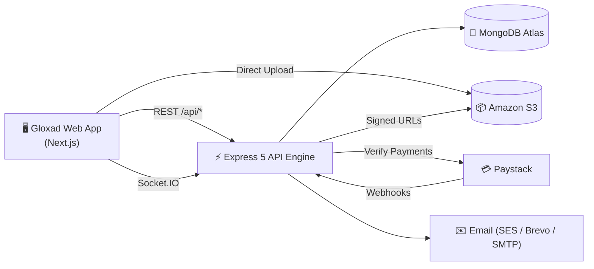

<div align="center">

# 🎓 Gloxad Academy — Backend API Engine

**The robust, high-performance RESTful API and real-time Socket.io service powering Gloxad Academy.**  
*Accounts, Course Taxonomy, Payments, Learning Progress, Trimester LMS & Real-time Live Classrooms.*

[](https://gloxard-backend.onrender.com/)
[](https://nodejs.org/)
[](https://expressjs.com/)
[](https://mongoosejs.com/)
[](https://socket.io/)
[](https://aws.amazon.com/s3/)
[](https://paystack.com/)

---

### 🌐 Official Live API Documentation
> **[https://gloxard-backend.onrender.com/](https://gloxard-backend.onrender.com/)**  
> *Full interactive reference portal with live endpoint testing, parameter schemas, and status codes.*

</div>

---

> [!TIP]
> **Frontend Integration Specification:**  
> For frontend developers and mobile engineers, complete technical contracts, canonical schema aliases, and delivery sign-offs are detailed in [**BACKEND_TO_FRONTEND_ALIGNMENT_DOC.md**](BACKEND_TO_FRONTEND_ALIGNMENT_DOC.md).

---

## 📑 Quick Navigation

* ⚡ [Quick Start](#-quick-start)
* 🏛️ [System Architecture](#-system-architecture)
* 🛠️ [What the API Does](#-what-the-api-does)
* 🔑 [Environment Configuration](#-environment-configuration)
* 📡 [API Endpoints Directory](#-api-endpoints-directory)
* 🧪 [Testing & Verification](#-testing--verification)
* 🚀 [Deployment](#-deployment)
* 👥 [Related Repositories](#-related-repositories)

---

## ⚡ Quick Start

### Prerequisites
* **Node.js**: v18.0.0 or higher
* **npm**: v9.0.0 or higher
* **MongoDB**: v6.0+ (Local instance or MongoDB Atlas cluster)

### 1. Clone & Install
```bash
git clone https://github.com/Gloxad-Academyteam/Gloxadbackend.git
cd Gloxadbackend
npm install
```

### 2. Configure Environment
```bash
cp .env.example .env
```
Open `.env` and set your credentials (at minimum `MONGODB_URI` and `JWT_SECRET`).

### 3. Start the Server
```bash
# Development (with nodemon auto-restart)
npm run dev

# Production start
npm start
```

The server listens on **port 3001** by default:
* **Interactive API Reference**: [http://localhost:3001/](http://localhost:3001/)
* **Health Check**: [http://localhost:3001/api/health](http://localhost:3001/api/health)

---

## 🏛️ System Architecture



### Core Technology Stack

| Layer | Technology | Purpose |
| :--- | :--- | :--- |
| **Runtime** | Node.js (ES Modules) | High-performance asynchronous execution |
| **Framework** | Express 5 | Next-generation lightweight web framework |
| **Database** | MongoDB + Mongoose 9 | Scalable document data store with schema validation |
| **Real-time** | Socket.IO 4 | Multi-room event messaging & live classroom channel |
| **Authentication** | JWT + bcrypt | Bearer token authorization with session invalidation |
| **File Storage** | AWS S3 Presigned URLs | Secure, direct-to-S3 media offloading (no server byte load) |
| **Payments** | Paystack API + Webhooks | Automated payment verification with 70/30 split |
| **Security** | Helmet + Rate Limiter + CORS | Strict HTTP security headers & DDoS mitigation |

---

## 🛠️ What the API Does

<details open>
<summary><b>Click to view feature breakdown by domain</b></summary>
<br>

| Domain | Key Capabilities |
| :--- | :--- |
| **🔐 Accounts & Auth** | Registration, 4-digit OTP email verification, secure login, password reset (5-digit OTP), session invalidation via `tokenVersion`, and token refresh. |
| **📚 Courses & Taxonomy** | Public course search with multi-filter facets, categories, sub-categories, topics, student reviews, and course moderation pipeline. |
| **🎓 Enrolments** | Instant free course enrolment, Paystack checkout verification, student enrollment progress tracking, and access guards. |
| **📈 Learning Engine** | Lesson progress tracking, server-side scored quizzes, private student notes, course Q&A threads, and verifiable certificates. |
| **👨‍🏫 Tutor Portal** | Expertise showcase application, 5-step incremental course wizard, revenue analytics, student review replies, and course rejection appeals. |
| **👑 Administration** | System metrics, user role governance, tutor vetting, course approval/rejection, broadcast announcements, and audit logging. |
| **📤 Media Uploads** | Short-lived (15 min) AWS S3 PUT presigned URLs for avatars, course thumbnails, lesson videos, PDFs, and private documents. |
| **💬 Real-Time Messaging** | Private 1-on-1 direct conversations and instant notifications delivered over Socket.io. |
| **🗓️ Trimester LMS** | Cohorts, weekly curriculum paths, student inquiries, live classes (YouTube stream embed, chat, polls, hand raise), and coding labs. |

</details>

---

## 🔑 Environment Configuration

Copy `.env.example` to `.env`. All configuration is validated at server startup.

<details>
<summary><b>Click to expand Environment Variables Guide</b></summary>
<br>

### 1. Server & Security
| Variable | Required | Default | Description |
| :--- | :---: | :--- | :--- |
| `PORT` | No | `3001` | HTTP server port |
| `NODE_ENV` | No | `development` | Environment mode (`development`, `test`, `production`) |
| `MONGODB_URI` | **Yes** | — | MongoDB Atlas connection string |
| `JWT_SECRET` | **Yes** | — | Secret key for JWT signing (minimum 32 characters in production) |
| `JWT_EXPIRES_IN` | No | `7d` | Lifetime for access tokens |
| `FRONTEND_ORIGIN`| No | — | Comma-separated extra allowed CORS origins |
| `LMS_TZ_OFFSET_MINUTES` | No | `60` | Offset in minutes from UTC (default: 60 = West Africa Time) |

### 2. Storage & AWS S3
| Variable | Required | Description |
| :--- | :---: | :--- |
| `AWS_REGION` | **Yes** | AWS S3 Bucket region (e.g. `eu-north-1` or `us-east-1`) |
| `AWS_ACCESS_KEY_ID` | **Yes** | IAM user access key with S3 PutObject / GetObject permissions |
| `AWS_SECRET_ACCESS_KEY` | **Yes** | IAM user secret key |
| `AWS_S3_BUCKET` | **Yes** | Target S3 bucket name |

### 3. Payments (Paystack)
| Variable | Required | Description |
| :--- | :---: | :--- |
| `PAYSTACK_SECRET_KEY` | **Yes** | Paystack secret API key (`sk_live_...` or `sk_test_...`) |

### 4. Email Services
| Variable | Purpose |
| :--- | :--- |
| `EMAIL_FROM` | Sender display name & email (`Gloxad Academy <noreply@gloxad.com>`) |
| `SITE_URL` | Public web address for links inside emails |
| `BREVO_API_KEY` | SendGrid / Brevo API dispatch |
| `RESEND_API_KEY` | Resend API dispatch |
| `SMTP_HOST`, `SMTP_PORT`, `SMTP_USER`, `SMTP_PASS` | Standard SMTP relay configuration |
| `SES_REGION` | Amazon SES dispatch region (SES enabled when set) |

</details>

---

## 📡 API Endpoints Directory

All routes are mounted under the `/api` prefix.  
*Interactive testing and request payloads are available at:* **[https://gloxard-backend.onrender.com/](https://gloxard-backend.onrender.com/)**

<details open>
<summary><b>Click to expand Endpoint Categories</b></summary>
<br>

### 1. Authentication (`/api/auth`)
* `POST /api/auth/signup` — Create student or instructor account
* `POST /api/auth/signin` — Authenticate and receive JWT Bearer token
* `POST /api/auth/refresh` — Refresh expired token within 5-min grace window
* `POST /api/auth/signout` — Revoke active token session
* `POST /api/auth/verify-email` — Verify email using 4-digit OTP
* `POST /api/auth/resend-verification` — Request fresh email verification OTP
* `POST /api/auth/forget-passwd` — Initiate password recovery (5-digit OTP)
* `POST /api/auth/verify-otp` — Validate recovery OTP without consumption
* `POST /api/auth/reset-passwd` — Set new password and invalidate prior sessions
* `POST /api/auth/update-password` — Change password for authenticated user
* `GET  /api/auth/me` — Retrieve authenticated user profile
* `PUT  /api/auth/update-profile` — Update bio, social handles, and avatar

### 2. Courses & Categories (`/api`)
* `GET  /api/categories` — List all categories, subcategories, and topics
* `GET  /api/courses` — Search, filter (free/paid/trimester), sort, and paginate courses
* `GET  /api/courses/:slugOrId` — View full course details (content shielded for non-enrolled)
* `POST /api/courses/:id/reviews` — Submit course rating and review
* `GET  /api/courses/:id/reviews` — List public reviews for a course

### 3. Enrollments & Payments (`/api/enrollments`)
* `POST /api/enrollments/enroll/:courseId` — Enroll directly in a free course
* `POST /api/enrollments/checkout` — Server-side Paystack payment verification
* `GET  /api/enrollments/my-courses` — Retrieve enrolled courses with progress
* `GET  /api/enrollments/check/:courseId` — Check user enrollment status

### 4. Learning Experience (`/api/learning`)
* `POST /api/learning/:courseId/progress` — Record lesson completion and position
* `POST /api/learning/:courseId/quiz/:quizId/submit` — Server-side quiz evaluation
* `POST /api/learning/:courseId/questions` — Post question to lesson Q&A
* `POST /api/learning/:courseId/notes` — Save private study notes
* `GET  /api/learning/:courseId/announcements` — List instructor announcements
* `GET  /api/learning/:courseId/certificate` — Issue or retrieve completion certificate
* `GET  /api/learning/verify-certificate/:certificateId` — Public certificate verification

### 5. Instructor Portal (`/api/tutor`)
* `POST /api/tutor/showcase-expertise` — Submit credentials for admin approval
* `GET  /api/tutor/dashboard-stats` — View student counts and rating metrics
* `GET  /api/tutor/earnings` — View transaction history and 70% revenue split
* `POST /api/tutor/courses` — Initialize new course draft (Step 1)
* `PUT  /api/tutor/courses/:id` — Update course wizard payload (Steps 2–4)
* `POST /api/tutor/courses/:id/submit` — Submit course for admin review
* `POST /api/tutor/courses/:id/appeal` — Appeal course rejection

### 6. Media & Presigned Uploads (`/api/upload`)
* `POST /api/upload/presigned-url` — Generate short-lived S3 upload URL (15-min expiry)
* `GET  /api/upload/signed-url` — Access private attachments and documents (5-min expiry)

### 7. Trimester LMS Core (`/api/lms`)
* `GET  /api/lms/cohorts/my` — List cohorts the authenticated student belongs to
* `GET  /api/lms/curriculum` — Get weekly curriculum path and active day states
* `GET  /api/lms/live-sessions` — List scheduled live classroom broadcasts
* `POST /api/lms/live-sessions/:id/join` — Join live class and stream embed
* `POST /api/lms/code-labs/:slug/submissions` — Submit coding lab exercises
* `POST /api/lms/inquiries` — Open student help inquiry ticket

### 8. Administration (`/api/admin`)
* `GET  /api/admin/dashboard-stats` — System-wide analytics and financial totals
* `GET  /api/admin/users` — Search and manage user accounts
* `PUT  /api/admin/tutors/:id/approval` — Approve or reject tutor application
* `GET  /api/admin/courses/pending` — Queue of courses awaiting publication review
* `PUT  /api/admin/courses/:id/status` — Publish or reject course with reason
* `POST /api/admin/broadcast` — Send notification broadcast to all active users

</details>

---

## 🧪 Testing & Verification

The test scripts call the API endpoints to verify authentication guards, RBAC, payloads, and error handling:

```bash
# 1. Start MongoDB and Dev Server in Terminal 1
npm run dev

# 2. Run Test Suites in Terminal 2
npm test             # Full end-to-end smoke test suite
npm run test:phase0  # S3 uploads, CORS, category images, token refresh
npm run test:lms     # Trimester LMS cohort, week, live class checks
npm run build        # Zero-syntax-error build verification check
```

---

## 🚀 Deployment

The live production API is hosted on **Render** with MongoDB Atlas and Amazon S3:

1. **Build Command**: `npm install`
2. **Start Command**: `npm start`
3. **Environment**: Ensure all variables in `.env.example` are configured in your hosting dashboard.
4. **Catalogue Population**: Run `npm run catalog:import` once after initial deployment to seed the 74 free technology courses.
5. **Health Verification**:
   * Liveness probe: `GET /api/health/liveness`
   * Readiness probe: `GET /api/health/readiness` (Verifies MongoDB & S3 connections)

---

## 👥 Related Repositories

| Repository | Description |
| :--- | :--- |
| [**Gloxad-Academyteam/Gloxadbackend**](https://github.com/Gloxad-Academyteam/Gloxadbackend) | Backend REST API, Socket.io Engine & Documentation |
| [**Gloxad-Academyteam/Gloxadapp**](https://github.com/Gloxad-Academyteam/Gloxadapp) | Gloxad Academy Frontend Web Application (Next.js) |

---

<div align="center">
  <sub>© 2026 Gloxad Academy. Designed and maintained by Livingstone Are ( stonescode ).</sub>
</div>