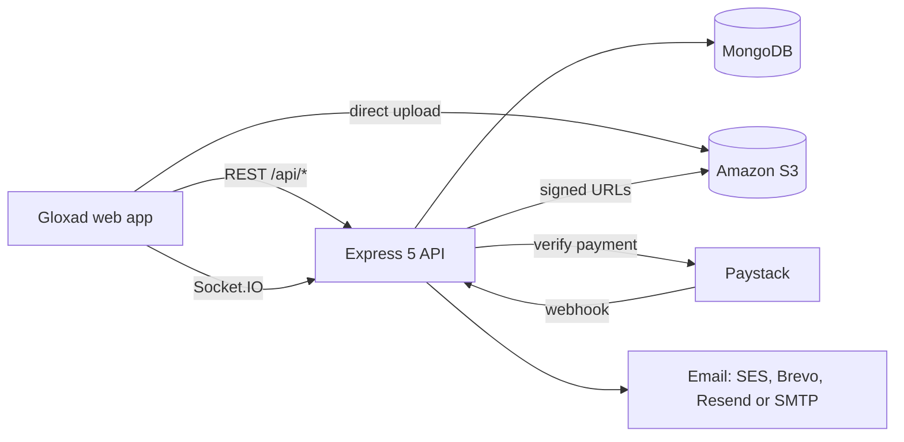
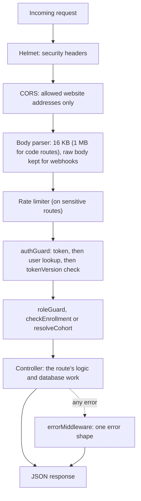
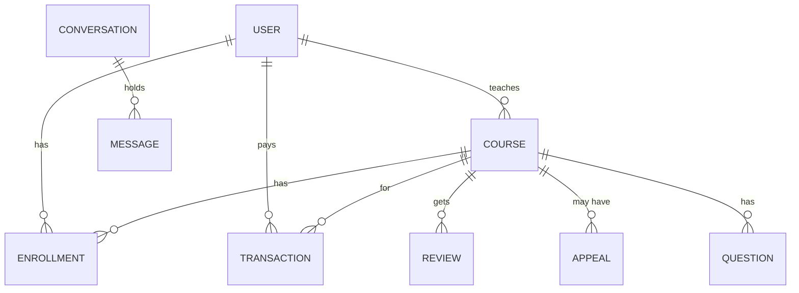
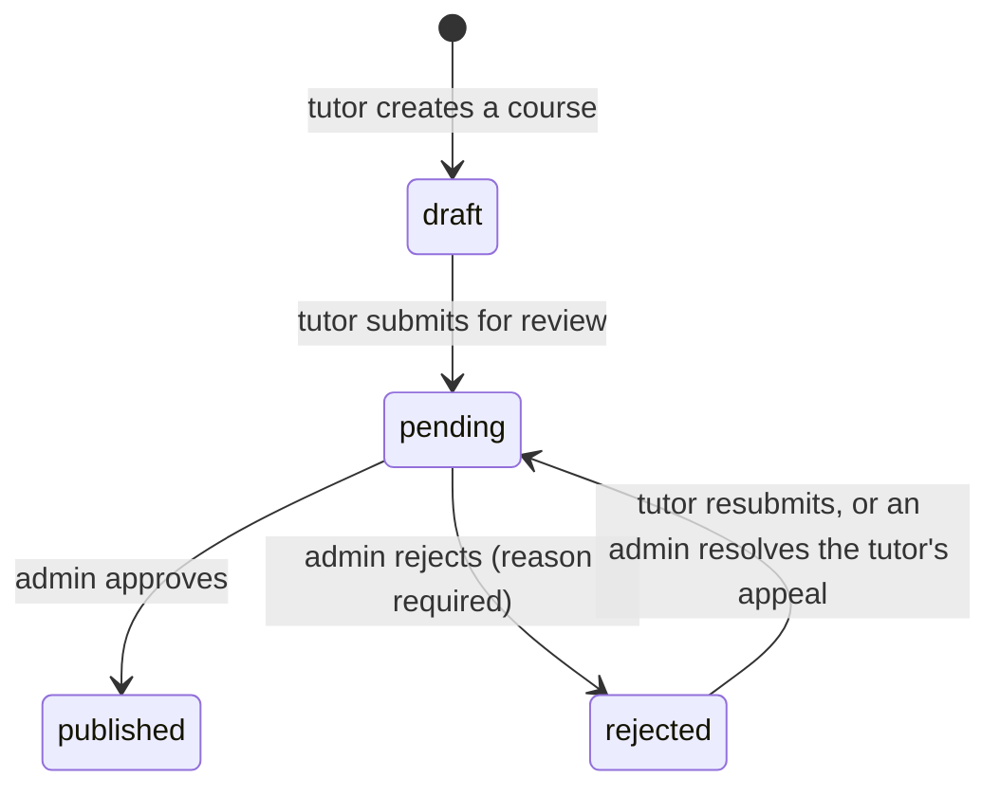
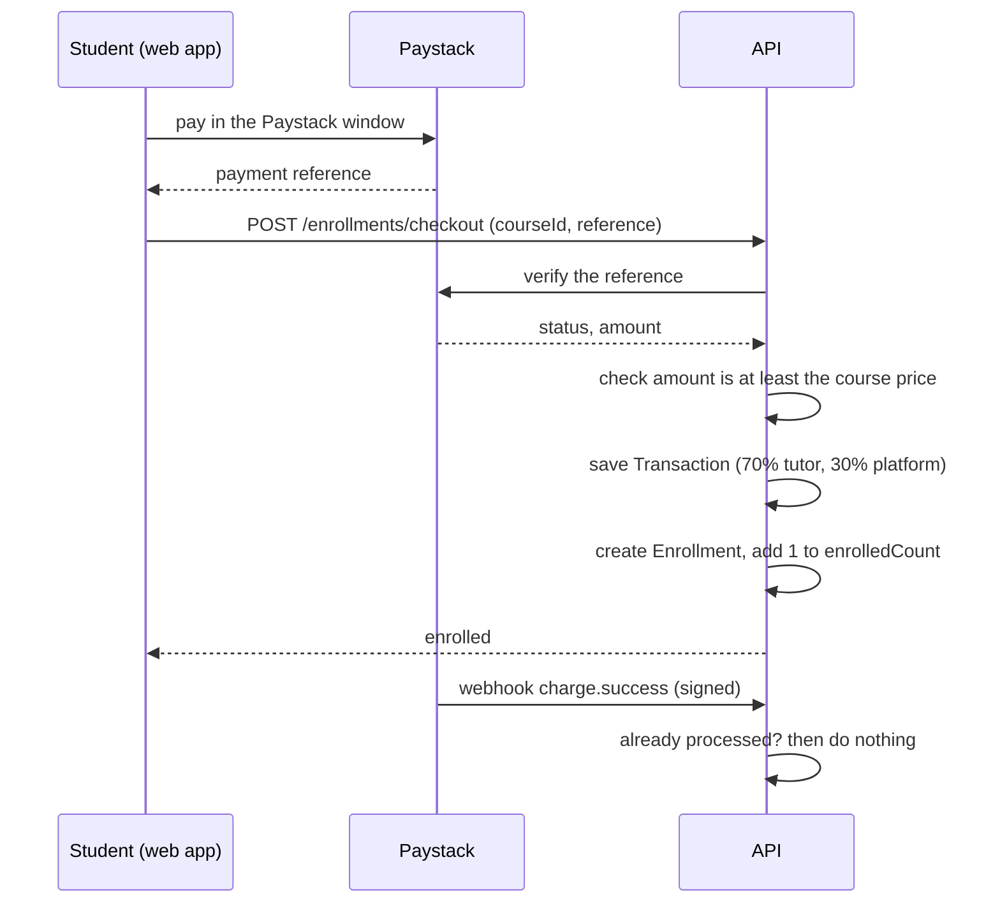
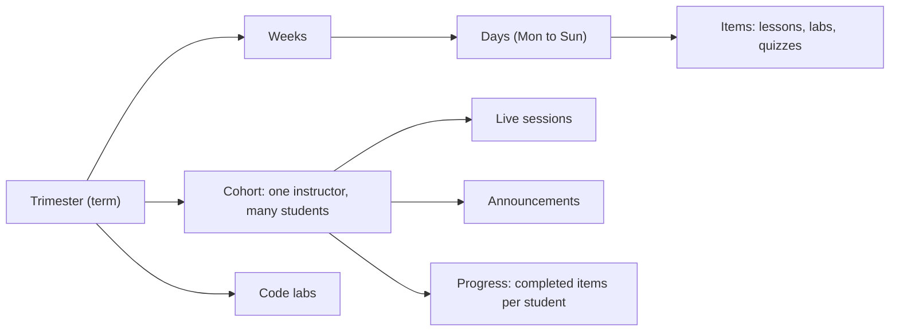
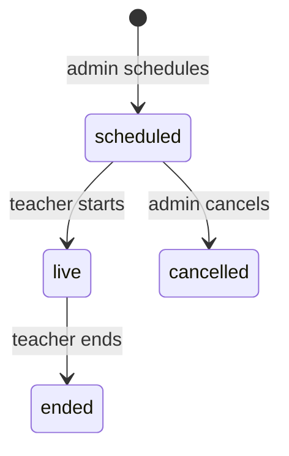

<p align="center">
  <picture>
    <source media="(prefers-color-scheme: dark)" srcset="docs/assets/gloxad-logo-white.png">
    
  </picture>
</p>

<h1 align="center">Gloxad Academy: Backend API</h1>

<p align="center">
  <strong>The API behind the Gloxad Academy web app</strong><br>
  Accounts, courses, enrolments, payments, learning progress, messaging, file uploads and the trimester LMS.
</p>

<p align="center">
  <a href="https://gloxard-backend.onrender.com/">
    
  </a>
</p>

<p align="center">
  🌐 <strong>Full Live API Documentation:</strong> <a href="https://gloxard-backend.onrender.com/"><strong>https://gloxard-backend.onrender.com/</strong></a>
</p>

---

## Contents

1. [About](#about)
2. [What the API does](#what-the-api-does)
3. [Architecture](#architecture)
4. [How it works](#how-it-works)
5. [Getting started](#getting-started)
6. [Environment variables](#environment-variables)
7. [Scripts](#scripts)
8. [API overview](#api-overview)
9. [Authentication and roles](#authentication-and-roles)
10. [Payments and revenue share](#payments-and-revenue-share)
11. [Email](#email)
12. [File uploads](#file-uploads)
13. [Real time](#real-time)
14. [The trimester LMS](#the-trimester-lms)
15. [Course catalogue import](#course-catalogue-import)
16. [Security](#security)
17. [Health checks and monitoring](#health-checks-and-monitoring)
18. [Project structure](#project-structure)
19. [Testing](#testing)
20. [Deployment](#deployment)
21. [Contributing](#contributing)
22. [Known issues](#known-issues)
23. [Related repositories](#related-repositories)

---

## About

Gloxad Academy is an online academy that teaches practical technology and business skills, built with Nigerian learners in mind. This repository is its backend: a Node.js REST API with real-time features, used by the [Gloxad web app](https://github.com/Gloxad-Academyteam/Gloxadapp).

It serves learners, tutors and administrators, and powers the **trimester programme**: cohort-based learning with weekly lessons, live classes, coding labs and announcements.

When the server is running locally, an **interactive API reference** is served at its root address (`GET /`), for example <http://localhost:3001/> (rendered from [`src/views/docs.html`](src/views/docs.html)).
The **official live documentation portal** for all API endpoints, parameters, request/response schemas, and authentication is hosted at:  
👉 **[https://gloxard-backend.onrender.com/](https://gloxard-backend.onrender.com/)**

For frontend developers and integration teams, the complete **Backend to Frontend Alignment Specification** covering all 55+ REST endpoints, Socket.io events, payload contracts, and verification sign-offs is available in [BACKEND_TO_FRONTEND_ALIGNMENT_DOC.md](BACKEND_TO_FRONTEND_ALIGNMENT_DOC.md).

---

## What the API does

| Area | Features |
| --- | --- |
| **Accounts** | Sign-up and sign-in, email verification with a one-time code, password reset, token refresh, profile updates, sign-out |
| **Courses** | Public course list with search and filters, course details by slug or id, categories with sub-categories and topics, reviews and ratings |
| **Enrolments** | Free enrolment, paid checkout with Paystack, "my courses" with progress, access checks |
| **Learning** | Lesson progress, quizzes, lesson questions and answers, private notes, announcements, certificates and public certificate verification |
| **Tutors** | Credential submission, course drafts, submit for review, appeals against rejection, earnings, dashboard statistics, reviews and replies, instructor search |
| **Admin** | Dashboard and recent activity, user management, tutor approval, course moderation, appeals, finance, broadcast messages, platform settings, review moderation |
| **Uploads** | Short-lived signed addresses for uploading files straight to Amazon S3 and for reading private files |
| **Messaging** | Direct conversations and notifications over Socket.IO |
| **Trimester LMS** | Trimesters, cohorts, weekly curriculum, progress, announcements, student inquiries, live classes (stream, chat, polls, raise hand, shared code), coding labs and submissions |
| **Catalogue** | A script that imports the 74-course free catalogue into the database |
| **Operations** | Interactive API docs, liveness and readiness checks, rate limiting |

---

## Architecture



| Layer | Choice |
| --- | --- |
| Runtime | Node.js (ES modules) |
| Framework | Express 5 |
| Database | MongoDB with Mongoose 9 |
| Real time | Socket.IO 4 |
| Auth | JSON Web Tokens, bcrypt password hashing |
| Storage | Amazon S3 (`@aws-sdk/client-s3`, presigned URLs) |
| Email | Amazon SES, Brevo, Resend or SMTP (Nodemailer) |
| Payments | Paystack |
| Hardening | Helmet, CORS allow-list, `express-rate-limit` |

---

## How it works

This section explains what happens inside the API.

### 1. A request's journey



- **`authGuard`** reads `Authorization: Bearer <token>`, checks the signature and expiry, loads the user, and rejects a deactivated account or a token whose `tokenVersion` no longer matches (a revoked session). Some public routes use `optionalAuth`, which attaches the user when there is a valid token and carries on without one otherwise.
- **`roleGuard("admin")`** (or `"instructor"`) returns 403 for anyone else. **`checkEnrollment`** lets admins and the course's own instructor through, and otherwise requires an enrolment. **`resolveCohort`** (LMS) finds the cohort and works out whether the caller is a student, the instructor or an admin of it.
- **`errorMiddleware`** gives every failure the same shape: `{ "error": "message" }`, plus `fields` for validation problems so forms can mark the right inputs. A duplicate key becomes 409, validation errors become 400, and token errors become 401.

### 2. Accounts and sessions

**Sign up** (`POST /auth/signup`)

1. Requires a first name, an email and a password of at least 8 characters, and rejects an email that is already used.
2. Builds a unique username (from the email, adding a number if taken). `instructor` signs up as `pending` approval, and everyone else as `approved`.
3. The password is hashed with bcrypt when the user is saved.
4. Creates a **4-digit** code, stores only its hash (15 minutes, 5 attempts), and emails it.
5. Returns a token **straight away**, even though the email is not verified yet. The web app is what makes the user verify before continuing. The API itself does not block unverified accounts.

**Verify** (`POST /auth/verify-email`). Finds the newest unused code, checks expiry and attempts, compares the hash, marks the code used, sets `isVerified`, and sends the welcome email.

**Sign in** (`POST /auth/signin`) takes an email or a username. Any problem returns the same "Invalid email or password" so attackers learn nothing. It records `lastLoginAt` and returns `{ token, user }`.

**The token** is a JWT holding `sub` (user id), `role` and `tokenVersion`, valid for 7 days by default.

**Revoking sessions.** Each user has a `tokenVersion`. Signing out, changing a password or resetting a password **adds 1** to it, so every token issued earlier stops working immediately, on every device.

**Refreshing.** `POST /auth/refresh` accepts a valid token or one that expired in the last 5 minutes, checks the user and `tokenVersion` again, and returns a new token.

**Password reset.** `POST /auth/forget-passwd` creates a **5-digit** code (15 minutes) and always answers "If the account exists, an OTP has been sent". `POST /auth/verify-otp` checks the code and `POST /auth/reset-passwd` sets the new password and revokes all sessions.

### 3. The data model



| Collection | What it holds |
| --- | --- |
| `User` | Account, role, approval status, profile, tutor credentials, `tokenVersion` |
| `Otp` | Hashed one-time codes for email verification and password reset |
| `Category` | Categories with sub-categories and topics, an icon and an image |
| `Course` | Details, modules (lessons and quizzes), price, status, catalogue fields (programme, pathway, video credit), `enrollmentOpen` |
| `Enrollment` | One student in one course: completed lessons, last position, quiz scores, progress, certificate id |
| `Transaction` | One Paystack payment: reference, amount, status, and the 70/30 split |
| `Review`, `Question`, `Note`, `Announcement` | Course reviews with a tutor reply, lesson questions, private notes, course announcements |
| `Appeal` | A tutor's appeal against a rejected course, and the admin's resolution |
| `Conversation`, `Message`, `Notification` | Direct messages and notifications |
| `PlatformSettings` | Switches such as allowing sign-ups and password reset |
| LMS collections | `Trimester`, `Week`, `Cohort`, `Progress`, `Announcement`, `Inquiry`, `LiveSession`, `LiveMessage`, `LiveAttendance`, `CodeLab`, `CodeSubmission` (see section 8) |

### 4. Courses



- A new course starts as a **draft** with a unique `slug` made from its title (a number is added if taken). Any account with the `instructor` role can create drafts: **the API does not check tutor approval**. The web app locks the upload form until an admin approves the tutor.
- **Submitting** (`POST /tutor/courses/:id/submit`) needs at least one module, a lesson video, and the welcome and congratulations messages. It moves the course to `pending`.
- **Appeals** (`POST /tutor/courses/:id/appeal`) are accepted only for rejected courses and need a message. An admin marks the appeal `resolved` (the course goes back to `pending` for another review) or `dismissed`.
- Admins moderate through `PUT /admin/courses/:id/status`. Rejecting needs a written reason, which the tutor sees.
- **The public list** (`GET /courses`) shows only `published` courses, **without their modules** (a course can have hundreds of chapters, and the cards do not show them). It supports full-text search, category and sub-category, `courseType`, level, price range and sorting (newest, most enrolled, price, rating). Pages hold at most 50 courses.
- **Content shield.** A single course (`GET /courses/:slugOrId`) includes a lesson's video address only for an enrolled student, the course's instructor, an admin, or when the lesson is a **free preview**. Quiz answer keys are removed for everyone except the instructor and admins.

### 5. Enrolment and payments



- **Free courses** skip payment: `POST /enrollments/enroll/:courseId` creates the enrolment directly, and refuses unpublished courses, non-free courses, and courses with `enrollmentOpen: false`.
- **Checkout** checks the amount against the course price (or the discount price), so a cheaper payment cannot unlock a dearer course. Paystack counts in kobo, so amounts are divided by 100.
- **Idempotent.** A reference that was already paid returns the existing enrolment rather than charging or enrolling twice.
- **The webhook** (`/webhooks/paystack`) is a safety net for when the student closes the browser before checkout finishes. It verifies the signature (HMAC-SHA512 over the raw body, compared in constant time), ignores everything except `charge.success`, finds the student and course from the payment's metadata, and creates the same records. It also creates an in-app notification for the student.

### 6. Learning

- **Progress** (`POST /learning/:courseId/progress`) needs an enrolment. It checks the lesson belongs to the course, records the last lesson and playback position, adds the lesson to `completedLessons` once, and recalculates `progressPercentage` as completed lessons divided by all lessons. At 100% the enrolment is marked complete. A course with no lessons counts as 100%.
- **Quizzes** (`POST /learning/:courseId/quiz/:quizId/submit`) take an `answers` list, compare each with the stored correct option, work out a percentage, compare it with the quiz's pass mark (default 70), and add the attempt to the enrolment's `quizScores`.
- **Certificates** (`GET /learning/:courseId/certificate`) are issued only at 100% progress. The first request creates a certificate id of the form `GLX-CERT-…`, built from the user and course ids, and stores it. `GET /learning/verify-certificate/:certificateId` is **public**, so anyone can check a certificate.
- **Questions, notes and announcements** belong to a course. Students and the instructor post questions and replies, a student's notes are private, and instructors post announcements.

### 7. Files

The API never handles file bytes. It only signs requests.

- `POST /upload/presigned-url` picks a folder (public: `avatars`, `categories`, `courses`, `logos`, `signatures`, `resources`; private: `certifications`, `documents`, `submissions`, `certificates`; anything else becomes `resources`), makes a unique key from the time, a random value and the cleaned file name, and returns an upload address valid for 15 minutes plus the final address.
- **Private** files get a key under the owner's id and **no public address**. They are read through `GET /upload/signed-url?key=…`, which returns a link valid for 5 minutes.
- **Mock mode.** The S3 client is created only when `AWS_ACCESS_KEY_ID` and `AWS_SECRET_ACCESS_KEY` are both set. Without them, uploads switch to a **fake local address** and log a notice. This code does not use an AWS server role, so give it keys even when hosting on AWS, and check the readiness route after deploying.

### 8. Real time

Socket.IO shares the HTTP server. On connection the handshake token is checked the same way as `authGuard`, so a connection always belongs to one user.

| Room | Who is in it | Used for |
| --- | --- | --- |
| `user:<id>` | That user only (a user can only join their own) | Private notifications |
| `conv:<id>` | Participants of a conversation | New messages, typing indicators |
| `live:<sessionId>` (on `/live`) | Members of the class's cohort | Live-class events |

Notifications are created in two places today: when a payment succeeds, and when an admin sends a broadcast. Each is saved and pushed to the user's room at once.

### 9. The trimester LMS



- **Who sees what.** An admin creates a trimester, fills in its weeks, creates a cohort and adds students. `resolveCohort` then limits every LMS request to the cohort the caller belongs to (or an explicit `cohortId` they belong to).
- **The weekly plan.** Each week has up to seven day slots with scheduled items. `decorateWeek` turns the plan, the cohort's start date and the student's completed items into what the screens show. A day is `done` (everything finished), `today`, `available` (past and unfinished), `upcoming` (not yet open) or `locked` (nothing scheduled).
- **"Today" and time zones.** The programme's day is worked out in its own time zone (`LMS_TZ_OFFSET_MINUTES`, default West Africa Time), so a day does not flip at 11 pm local time. The current week is counted from the cohort's start date and kept between 1 and the last week.
- **Progress.** One `Progress` record per student and cohort lists the completed item ids. Week progress is finished items divided by scheduled items, and the dashboard's "up next" and "upcoming" lists come from the date-ordered list of all items.
- **Live classes.**



  A learner can join from **15 minutes before** the start. Joining records attendance (one record per person) and returns the YouTube stream. The teacher pastes a YouTube link (watch, live, embed, short or `youtu.be`), and the API extracts the video id. Chat, polls (teachers open and close them), hand-raising, the people list and a shared code panel hang off the session. Status changes are pushed to the class's socket room.
- **Code labs.** A lab has starter files, a read-only tests file, steps and hints. A student's submission (up to 10 files of 100,000 characters each) is saved with the pass and total counts **reported by the browser**. The server does not run the code, so the numbers are stored as unverified.
- **Inquiries.** A learner's question to the team gets a reference such as `INQ-2026-A1B2C3`, and an admin answers it.

### 10. The course catalogue

`catalog:import` reads `src/data/gloxadCourses2026.json` and, for each course, finds its category by name and the course by slug, then creates or updates it as a published course owned by one account. Each video becomes one module, and each **chapter** of that video becomes one lesson, marked as a free preview. A lesson carries `youtubeId`, `startSeconds` and `endSeconds` as well as its title and `videoUrl` (with a `&t=` start time). A video with no chapters becomes one lesson. On a re-import, modules and lessons that already exist (same video and chapter start) keep their ids, so a learner's saved progress still points at the right lesson. Because matching is by slug and nothing is deleted, running it again is safe, and it keeps a price an admin has set.

### Limits worth knowing

- Quiz and code-lab results can be trusted only as far as the client: quizzes are scored on the server, code labs are not.
- Unverified accounts receive a token. Only the web app enforces email verification.
- Tutor approval is not enforced by the API when creating or submitting courses. Only the web app blocks unapproved tutors.
- Notifications exist for payments and admin broadcasts only.
- There is no unit-test framework and no automated checks on pull requests.

---

## Getting started

You need **Node.js 18 or newer** (Express 5 requires it), **npm**, and a **MongoDB** database (local or hosted).

```bash
git clone https://github.com/Gloxad-Academyteam/Gloxadbackend.git
cd Gloxadbackend
npm install
cp .env.example .env
```

Edit `.env` and set at least `MONGODB_URI` and `JWT_SECRET` (see [Environment variables](#environment-variables)). Then:

```bash
npm run dev      # restarts on file changes
# or
npm start        # plain start
```

The API listens on port **3001** unless `PORT` is set. Open <http://localhost:3001/> for the API reference and <http://localhost:3001/api/health> to check it is up.

### Load sample data

```bash
npm run seed
```

> **Warning: `npm run seed` deletes existing users, OTP codes, categories, courses and enrolments before inserting sample data.** Use it only on a local or test database. Never run it against production.

The seed creates an admin, two approved tutors, one tutor pending approval and two students, all on the `@gloxad.com` domain (for example `admin@gloxad.com`, `jane.tutor@gloxad.com`, `alice.student@gloxad.com`).

> **Security: these sample accounts must not exist in production.** Their shared password is written in plain text in `src/seed.js` and in the test scripts, and this repository is public, so anyone can read it. If the seed has ever been run against a live database, delete those accounts or change their passwords now, and rotate `JWT_SECRET` afterwards.

---

## Environment variables

Copy `.env.example` to `.env`. The `.env` file is ignored by Git. **Never commit secrets.**

### Core

| Variable | Purpose | Default and notes |
| --- | --- | --- |
| `PORT` | HTTP port | `3001` |
| `MONGODB_URI` | MongoDB connection string | **Required** |
| `JWT_SECRET` | Secret for signing tokens | **Required.** Use 32 or more characters. In production the server refuses to start without it. |
| `JWT_EXPIRES_IN` | Token lifetime | `7d` |
| `FRONTEND_ORIGIN` | Extra allowed website addresses, comma-separated | `http://localhost:3000`, `https://gloxadacademy.com` and `https://www.gloxadacademy.com` are always allowed |
| `NODE_ENV` | `production` turns on stricter behaviour | Set to `production` when deployed |
| `LMS_TZ_OFFSET_MINUTES` | Minutes from UTC used to decide what "today" is in the LMS | `60` (West Africa Time) |

### Email (see [Email](#email))

| Variable | Purpose |
| --- | --- |
| `EMAIL_FROM` | Sender, for example `Gloxad Academy <noreply@gloxadacademy.com>`. Must be a sender your email provider has verified. |
| `SITE_URL` | Public website address used for links and images in emails (default `https://www.gloxadacademy.com`) |
| `BREVO_API_KEY` | Send through Brevo |
| `RESEND_API_KEY` | Send through Resend |
| `SMTP_HOST`, `SMTP_PORT`, `SMTP_USER`, `SMTP_PASS`, `SMTP_FROM` | Send through any SMTP server |
| `SES_REGION` | Send through Amazon SES in that region. SES is off unless this is set. |
| `SES_CONFIGURATION_SET` | Optional SES configuration set for bounce and complaint tracking |

### Storage and payments

| Variable | Purpose |
| --- | --- |
| `AWS_REGION`, `AWS_ACCESS_KEY_ID`, `AWS_SECRET_ACCESS_KEY`, `AWS_S3_BUCKET` | Amazon S3 for uploads. **Both keys are required.** Without them uploads run in mock mode (see [How it works](#7-files)), and the server's AWS role is not used. |
| `PAYSTACK_SECRET_KEY` | Paystack secret key. In production there is no fallback: without it, payment webhooks and verification fail closed. |

### Catalogue import

| Variable | Purpose |
| --- | --- |
| `CATALOG_OWNER_EMAIL` | The account that owns imported courses. If unset, the first admin is used. |

---

## Scripts

| Command | What it does |
| --- | --- |
| `npm start` | Starts the API |
| `npm run dev` | Starts the API with automatic restarts (nodemon) |
| `npm run build` | Checks every source file for syntax errors |
| `npm run seed` | Loads sample data (**deletes existing data**) |
| `npm run catalog:import` | Imports the course catalogue. Add `-- --dry-run` to preview. |
| `npm test` | Runs the end-to-end smoke tests (needs the server and database running) |
| `npm run test:smoke`, `npm run test:phase0`, `npm run test:lms` | Individual test suites |

---

## API overview

All routes start with `/api`. Send `Authorization: Bearer <token>` for protected routes. Errors look like `{ "error": "message" }`. 

* **Live Interactive Documentation:** **[https://gloxard-backend.onrender.com/](https://gloxard-backend.onrender.com/)**
* **Local Reference Portal:** Served live at root address `GET /` via [`src/views/docs.html`](src/views/docs.html).
* **Comprehensive Integration & Spec Document:** Full endpoint specifications, verification matrices, and canonical field mappings are documented in [BACKEND_TO_FRONTEND_ALIGNMENT_DOC.md](BACKEND_TO_FRONTEND_ALIGNMENT_DOC.md).

| Area | Base path | Main routes |
| --- | --- | --- |
| Auth | `/api/auth` | `POST /signup`, `/signin`, `/refresh`, `/signout`, `/verify-email`, `/resend-verification`, `/forget-passwd`, `/verify-otp`, `/reset-passwd`, `/update-password`; `GET /me`; `PUT /update-profile` |
| Categories | `/api` | `GET /categories` |
| Courses | `/api` | `GET /courses`, `/courses/:slugOrId`, `/courses/:id/reviews`; `POST /courses/:id/reviews` |
| Enrolments | `/api/enrollments` | `POST /enroll/:courseId` (free), `POST /checkout` (paid); `GET /my-courses`, `/check/:courseId` |
| Learning | `/api/learning` | `POST /:courseId/progress`, `/:courseId/quiz/:quizId/submit`, `/:courseId/questions`, `/:courseId/notes`; `GET /:courseId/announcements`, `/:courseId/certificate`, `/verify-certificate/:certificateId` |
| Tutor | `/api/tutor` | `POST /showcase-expertise`; `GET /dashboard-stats`, `/earnings`, `/search-instructors`, `/reviews`; `POST /reviews/:id/reply`; courses: `POST` and `GET /courses`, `GET` and `PUT /courses/:id`, `POST /courses/:id/submit`, `POST /courses/:id/appeal` |
| Admin | `/api/admin` | `GET /dashboard-stats`, `/users`, `/finance`, `/settings`, `/reviews`, `/appeals`, `/courses/pending`, `/courses/all`; `PUT /tutors/:id/approval`, `/courses/:id/status`, `/appeals/:id/status`, `/settings`; `POST /broadcast`; `DELETE /users/:id`, `/reviews/:id` |
| Uploads | `/api/upload` | `POST /presigned-url`, `GET /signed-url` |
| Messages | `/api/messages` | `GET /conversations`, `/:conversationId`; `POST /conversations/new`, `/:conversationId` |
| Notifications | `/api/notifications` | `GET /`, `POST /mark-read` |
| Webhooks | `/api/webhooks` | `POST /paystack` |
| Trimester LMS | `/api/lms` | See [The trimester LMS](#the-trimester-lms) |
| Health | `/api` | `GET /health`, `/health/liveness`, `/health/readiness` |

Lists use `?page=` and `?limit=`. `GET /api/courses` answers `{ courses, pagination }`.

---

## Authentication and roles

- Sign-up and sign-in return `{ token, user }`. Tokens last 7 days by default.
- Passwords are hashed with bcrypt. Sign-in, sign-up, password reset and verification routes are rate limited.
- New accounts verify their email with a one-time code that expires after 15 minutes.
- `POST /auth/refresh` accepts a token that expired only recently and returns a fresh one.

| Role | Can do |
| --- | --- |
| `student` | Own profile, enrolments and progress, reviews, messages |
| `instructor` | Everything a student can, plus create and submit courses. Admins approve tutors (`pending`, `approved` or `rejected`) and approve each course before it is published. |
| `admin` | Everything: users, approvals, moderation, finance, settings, the LMS setup |

Course status moves through `draft`, `pending`, `published` and `rejected`. A rejected course can be appealed.

---

## Payments and revenue share

- A course is `free`, `paid` or `trimester` (`courseType`). A course with price 0 is imported as free.
- **Free courses:** `POST /api/enrollments/enroll/:courseId` enrols the student. It returns 400 if the course is not published, is not free, or has `enrollmentOpen: false`.
- **Paid courses:** the student pays through Paystack in the browser, then the app calls `POST /api/enrollments/checkout` with the payment reference. The API verifies it and is safe to call twice with the same reference.
- **Webhook:** `POST /api/webhooks/paystack` handles `charge.success` events. It checks the `x-paystack-signature` header (HMAC-SHA512), creates the enrolment, and records the revenue split of **70% to the instructor and 30% to the platform**.

---

## Email

The API sends verification codes, password resets and welcome emails. It tries providers in this order and uses the first one that succeeds:

1. **Amazon SES**, if `SES_REGION` is set
2. **Brevo**, if `BREVO_API_KEY` is set
3. **Resend**, if `RESEND_API_KEY` is set
4. **SMTP**, if `SMTP_HOST` and `SMTP_USER` are set

If none is configured:

- In **development**, the email is printed to the console and appended to `.dev-emails.log`, so you can copy the code while testing.
- In **production**, the send is reported as failed and logged as `[EMAIL NOT SENT]`. It does not pretend to succeed.

Whatever the provider, `EMAIL_FROM` must be a sender it has verified. Templates (verification, password reset, welcome) are in `src/utils/email.js` and share one Gloxad layout. They load the logo from `SITE_URL`, so the logo appears in emails once the website serves `/email/gloxad-logo.png`.

For good delivery, set up SPF, DKIM and DMARC records for the sending domain with your provider.

---

## File uploads

The browser never sends files through the API. Instead:

1. The app calls `POST /api/upload/presigned-url` with the folder and file type.
2. The API returns a short-lived upload address, the final file address and the storage key.
3. The browser uploads the file directly to Amazon S3.
4. The app saves the file address on the profile, course or other record.

Private files are read through `GET /api/upload/signed-url?key=...`, which returns a short-lived link for authorised users. The S3 bucket must allow `PUT`, `GET` and `HEAD` from the website's addresses (CORS).

---

## Real time

Socket.IO runs on the same server and port. Clients connect with the login token as `auth: { token }`.

- **Default namespace (messaging and notifications).** Client events: `join_user`, `join_conversation`, `leave_conversation`, `typing`, `stop_typing`. Server events: `new_message`, `new_notification`, `typing`, `stop_typing`.
- **`/live` namespace (live classes).** Clients join a session with `join_session`. The server pushes chat, poll, hand-raise and session events to everyone in that class.

---

## The trimester LMS

Everything is under `/api/lms`. Students see only the cohorts they belong to, and teachers and admins have extra routes.

| Area | Routes |
| --- | --- |
| My cohorts | `GET /me`, `GET /dashboard`, `GET /curriculum`, `GET /curriculum/weeks/:weekNumber`, `POST /progress` |
| Announcements | `GET /announcements`, `POST /announcements` (teachers) |
| Inquiries | `POST /inquiries`, `GET /inquiries`, `GET /inquiries/:id` |
| Live classes | `GET /live-sessions`, then per session `/live-sessions/:id`: `GET /`, `POST /join`, `GET` and `POST /chat`, `POST /polls`, `POST /polls/:pollId/vote`, `POST /polls/:pollId/close`, `POST /hand`, `GET /people`, `PUT /stream`, `POST /start`, `POST /end`, `PUT /shared-code` |
| Code labs | `GET /code-labs`, `GET /code-labs/:slug`, `POST /code-labs/:slug/submissions`, `GET /code-labs/:slug/submissions/me` |
| Admin setup | `GET` and `POST /admin/trimesters`, `PUT /admin/trimesters/:id/weeks/:weekNumber`, `GET` and `POST /admin/cohorts`, `POST /admin/cohorts/:id/students`, `DELETE /admin/cohorts/:id/students/:userId`, `POST /admin/live-sessions`, `POST /admin/live-sessions/:id/cancel`, code lab management, inquiry replies |

Live classes are streamed through YouTube: the teacher sets the stream address, and the API handles chat, polls, hand-raising, attendance of who joined and a shared code panel around it. Chat and code submissions are rate limited. Code routes accept up to 1 MB of source code; every other route accepts 16 KB.

`npm run test:lms` exercises these routes, and `src/seedLms.js` has LMS sample data.

---

## Course catalogue import

The 74-course free catalogue (freeCodeCamp videos in 10 categories) is stored in `src/data/gloxadCourses2026.json`, the same file the website bundles.

```bash
npm run catalog:import -- --dry-run   # show what would change
npm run catalog:import                # write to the database
```

- Categories are matched by name and courses by slug, so it is safe to run again. Nothing is deleted, and enrolments, ratings and counts are left alone.
- Courses are owned by `CATALOG_OWNER_EMAIL`, or the first admin if that is not set.
- A course with price 0 is imported as `free` with enrolment open. A price an admin has set by hand is kept.
- Every lesson is a free preview, because the videos are public on YouTube. Each video's chapters come from the file the website's `scripts/update-catalog-chapters.py` writes (`--backend` produces this repository's `src/data/gloxadCourses2026.json` with the chapters included).

The catalogue videos belong to their creators. Course pages must credit the creator and link to the original video, and free third-party videos must never be used to sell paid courses.

---

## Security

- **Helmet** sets security headers.
- **CORS** allows only the listed website addresses (`FRONTEND_ORIGIN` plus the built-in ones).
- **Rate limits** protect sign-in, sign-up, password reset, verification, profile updates, live chat, inquiries and code submissions.
- **Body limits:** 16 KB normally, 1 MB only for code routes. The raw request body is kept so webhook signatures can be checked.
- **Webhooks** are verified by signature. Paystack payment events are handled idempotently.
- **Secrets** come from environment variables only. The server refuses to start in production without `JWT_SECRET`, and the Paystack key has no fallback in production.
- **Passwords** are hashed with bcrypt and never returned by the API.

Report security problems privately to the maintainers instead of opening a public issue.

---

## Health checks and monitoring

| Route | Meaning |
| --- | --- |
| `GET /api/health` | The process is up. Kept for older clients. |
| `GET /api/health/liveness` | The process is up and answering. |
| `GET /api/health/readiness` | MongoDB (and S3, when configured) are reachable. Returns 503 when not ready. |

Point an uptime monitor at the readiness route.

---

## Project structure

```text
gloxard-backend/
  src/
    index.js          Starts the HTTP server, Socket.IO and the database connection
    app.js            Express app: security, CORS, parsers, route mounting, health, docs
    config/           env.js (settings) and db.js (MongoDB connection)
    routes/           One file per area: auth, course, tutor, admin, lms, ...
    controllers/      The logic behind each route
    models/           Mongoose models: User, Course, Enrollment, Transaction, Lms, ...
    middlewares/      auth, roles, rate limits, webhook signature, errors, LMS access
    utils/            email, S3, JWT, Paystack, YouTube, LMS scheduling
    socket/           Socket.IO handlers (messaging and /live)
    data/             The course catalogue JSON
    views/            docs.html: the interactive API reference (served live at GET /)
    seed.js           Sample data (deletes existing data)
    seedLms.js        LMS sample data
  scripts/            Import script, build check, and test scripts
  docs/assets/        Logo files used by this README
  BACKEND_TO_FRONTEND_ALIGNMENT_DOC.md   Comprehensive API specification and frontend alignment guide
  IMPLEMENTATION_PLAN.md                 The original architecture and milestone plan
```

---

## Testing

The test scripts in `scripts/` call a **running** API, so start MongoDB and the server first:

```bash
npm run seed         # on a test database only
npm run dev          # in one terminal
npm test             # in another: runs the smoke tests
npm run test:lms     # LMS routes
npm run test:phase0  # health, CORS, upload folders, category images, token refresh
```

`npm run build` is a quick syntax check of every source file. There is no unit-test framework configured yet, and no automated checks on pull requests.

---

## Deployment

The live API is currently hosted on **Render** at `https://gloxard-backend.onrender.com`. On Render's free plan the service sleeps when idle, so the first request after a quiet period can take 30 to 60 seconds; a paid instance stays awake. A move to AWS is being considered.

For any host:

1. Set `NODE_ENV=production`, `MONGODB_URI`, `JWT_SECRET` and the other variables above.
2. Use `npm start` as the start command.
3. Allow WebSocket connections (Socket.IO needs them).
4. Add the production website address to `FRONTEND_ORIGIN` if it is not already built in.
5. Set up a verified email sender, the Paystack secret key, and the S3 bucket with CORS.
6. After deploying, run `npm run catalog:import` once to load the catalogue.
7. Check `GET /api/health/readiness`.

---

## Contributing

- Never push straight to the main branch (`master`). Work on a branch, open a pull request, and merge only after review.
- Use short, clear commit messages that say what changed and why.
- Run `npm run build` before opening a pull request, and test the routes you changed.
- Never commit `.env` files, keys or real user data.
- Keep controllers small, validate input on the server, and return `{ error }` with a suitable status code.

---

## Known issues

- **Sample-account password in a public repository.** `src/seed.js` and the scripts in `scripts/` contain the seed accounts' password. Check that no `@gloxad.com` sample account exists in the live database, move test credentials to environment variables, and consider making the repository private.
- No unit-test framework and no continuous-integration checks.
- `nodemon` is listed under `dependencies` (version 1.14) instead of `devDependencies`, and both `bcrypt` and `bcryptjs` are installed. Check which is used and remove the other.
- The API reference page and `IMPLEMENTATION_PLAN.md` may not match every route added since they were written.
- The requirements still to build include institution partner endpoints, quizzes and assignments with grading, a community forum and certificates for the trimester LMS, and an OpenAPI file. They are listed in the web app's `docs/Gloxad-Backend-Requirements-Next-Steps.pdf`.

---

## Related repositories

| Repository | Purpose |
| --- | --- |
| [`Gloxad-Academyteam/Gloxadapp`](https://github.com/Gloxad-Academyteam/Gloxadapp) | The web app (Next.js) |
| [`Gloxad-Academyteam/Gloxadbackend`](https://github.com/Gloxad-Academyteam/Gloxadbackend) | This API |

No license file has been chosen yet. Until one is added, ask the team before reusing this code.

<p align="center"><sub>© 2026 Gloxad Academy</sub></p>
# Gloxadbackend

