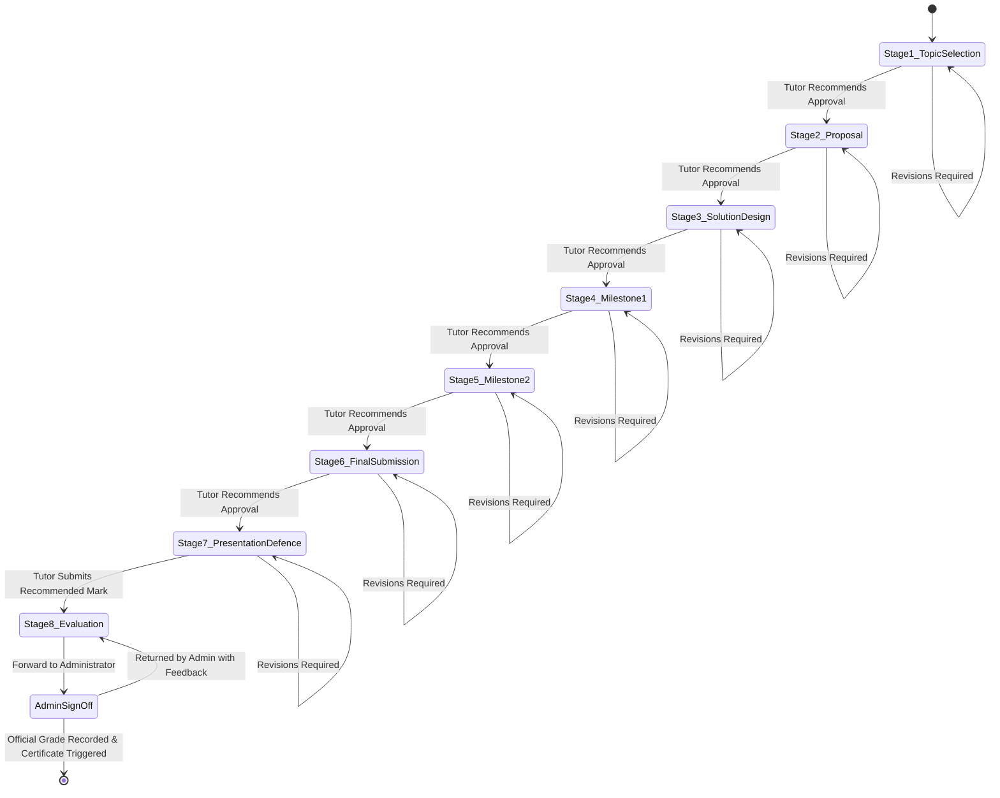

# Specification 22: Academic Governance, Grading Engine, Workspaces & Judge0 Runner (Phases 2–5)

> **Master Build Plan**: [`00-build-plan.md`](file:///c:/Users/THE%20LAPTOP%20STORE/Desktop/gloxard/context/specs/00-build-plan.md)  
> **Source Document**: Gloxad LMS Backend Technical Specification (v1.1, 11 Nov 2026) Handover Task List  
> **Progress Tracker**: [`progress-tracker.md`](file:///c:/Users/THE%20LAPTOP%20STORE/Desktop/gloxard/context/progress-tracker.md)  
> **Target Path**: `context/specs/22-handover-phases-2-to-5-specification.md`  
> **Runtime**: Node.js (ESM), Express.js 5, MongoDB (Mongoose 9), AWS S3, LiveKit, Judge0 (Self-Hosted on AWS EC2 / Cloud)

---

## 1. System Vision & Architecture Invariants

This specification realizes **Phases 2 through 5** from the approved Gloxad LMS Backend Technical Specification (v1.1). It establishes academic governance, an 8-stage final project state machine, a weighted multi-component grading engine, live classroom recording egress, persistent 3-layer workspaces, and server-side code execution via Judge0.

### Universal Architectural Invariants
1. **Configurable by Data, Not Hardcoded**: Assessment weights, deadlines, rubrics, score penalty caps, categories, and provider permissions are stored in MongoDB.
2. **Backend as Source of Truth**: The backend strictly computes progress, grades, workflow states, and recording availability; the frontend only renders them.
3. **Strict State Separation**:
   - *Watching a recording* $\neq$ *Live attendance*.
   - *Saving an autosave draft* $\neq$ *Formal submission*.
   - *Pushing to GitHub* $\neq$ *Submitting an assignment*.
   - *Browser test execution* $\neq$ *Verified grade* (remains `unverified: true`).
   - *Tutor grade recommendation* $\neq$ *Official grade* (waits for Administrator sign-off).
   - *Content completion* $\neq$ *Certificate eligibility*.
4. **Zero Silent Overwrites**: Every resubmission, grade edit, policy change, and status transition appends an immutable audit record.
5. **Uniform Error Standard**: All failures return `{ "error": "<message>" }` with standard HTTP codes.

---

## 2. Phase 2: Academic Governance & Grading Engine

### 2.1 Eight-Stage Final Project State Machine

The final project workflow enforces a strict sequential state machine across 8 standardized milestones:



#### The 8 Stages:
1. `topic_selection`: Student selects topic from tutor catalog or submits custom topic and scope.
2. `proposal_objectives`: Detailed project proposal, business goals, and technical feasibility.
3. `solution_design`: Architecture diagrams, database schemas, API specs, and planning milestones.
4. `milestone_1`: Core foundational code, database setup, and proof of concept.
5. `milestone_2`: Full feature implementation and functional integration.
6. `final_submission`: Final production code, repository URL, live deployment URL, and test coverage report.
7. `presentation_defence`: Scheduled live defense session with slide deck and presentation recording.
8. `final_evaluation`: Tutor grading with rubric breakdown and recommendation forwarded to Admin.

#### State Machine Invariants:
- A student **cannot** submit Stage $N+1$ until Stage $N$ is `approved`.
- If a stage is marked `revisions_required`, the student resubmits for that stage without resetting previously approved milestones.
- **Tutor vs Admin Separation**: Tutors recommend marks and approve stages 1–7. Stage 8 requires Administrator final approval before the score becomes official in the cohort gradebook.

---

### 2.2 Reusable Grading Engine & Weighted Assessment Formula

#### Assessment Categories & Spec Defaults:
Assessments are categorized into 7 standard types, with default percentage weights summing to $100\%$:

| Assessment Category | Default Weight | Description & Auto/Manual Rule |
| :--- | :---: | :--- |
| **Quizzes & Tests** | **15%** | Auto-graded server-side; answers shielded until attempt completion. |
| **Assignments** | **15%** | Tutor-graded via rubric; supports text, PDF, GitHub URL, S3 files. |
| **Practical Exercises** | **15%** | Guided lab walkthroughs; tutor or sandbox verified. |
| **Coding Challenges** | **10%** | Auto-graded via Judge0 sandbox runner; test suite verification. |
| **Live Attendance & Participation** | **10%** | Tracked via live join/leave events ($\ge 80\%$ duration per class). |
| **Weekly Assessments & Tasks** | **10%** | Module checkpoint written tasks and reflection summaries. |
| **Final Capstone Project** | **25%** | 8-stage state machine; tutor evaluation + Admin sign-off. |
| **Total** | **100%** | Cohort validator guarantees weights strictly sum to $100\%$. |

#### Weighted GPA Formula:
$$\text{Final Weighted Grade} = \sum_{k=1}^{7} \left( \frac{\text{EarnedPoints}_k}{\text{MaxPoints}_k} \times \text{Weight}_k \right)$$

*Raw marks are stored independently of weighted marks* (e.g. 80/100 on Assignments yields $80\% \times 15\% = 12/15$ points).

#### Late & Resubmission Penalty Caps:
Configurable score caps applied as upper bounds (not automatic grades):
- **On-time submission**: $100\%$ of max score.
- **1st deadline missed or 1st resubmission**: $66.7\%$ cap (e.g. max 10/15).
- **2nd resubmission / late attempt**: $33.3\%$ cap (e.g. max 5/15).
- **Subsequent attempts**: $13.3\%$ cap (e.g. max 2/15).
- **No submission / rejected without resubmission**: $0\%$.
- The applied policy is recorded on the submission and displayed to student and tutor.

---

### 2.3 Gradebooks & Audit History

#### 1. Student Gradebook (`GET /api/lms/cohorts/:cohortId/my-transcript`):
- Itemized list of all assessments with status, due date, raw score, weighted contribution, and penalty caps applied.
- Overall calculated weighted grade and passing status ($\ge 70\%$).
- Clear visibility of outstanding deliverables.

#### 2. Tutor Class Gradebook (`GET /api/lms/cohorts/:cohortId/gradebook`):
- Full student roster with individual assessment marks and final letter grades:
  - **A**: $90.0\% - 100.0\%$
  - **B**: $80.0\% - 89.9\%$
  - **C**: $70.0\% - 79.9\%$ (Pass mark)
  - **D**: $60.0\% - 69.9\%$
  - **F**: $< 60.0\%$
- Exportable to CSV format via `GET /api/lms/cohorts/:cohortId/gradebook/export`.

#### 3. Grade Audit Collection (`GradeAudit`):
Every manual grade change, override, or weight modification stores:
- `cohortId`, `studentId`, `assessmentId`
- `previousMark`, `newMark`
- `reason` (mandatory string)
- `actor` (User ObjectId) and `actorRole` (`instructor` | `admin`)
- `timestamp`

#### 4. Certificate Eligibility Gate:
Eligibility for an official Programme Certificate requires all three independent criteria:
1. `learningCompletion`: All mandatory curriculum modules cleared.
2. `academicPerformance`: Weighted final score $\ge 70\%$.
3. `governanceApproval`: Live attendance $\ge 70\%$, all required assessments submitted, and Final Project approved with Admin sign-off.

---

## 3. Phase 3: Live Learning, Attendance & Automatic Recording

### 3.1 LiveKit WebRTC Primary Classroom
- **Provider Strategy**: LiveKit Cloud WebRTC is the primary interactive classroom engine (bidirectional audio/video, screen share, hand raise, audio-only mode, and whiteboard). YouTube Live remains secondary for public webinars and broadcast keynotes.
- **10-Minute Server Join Gate**: Students can join LiveKit rooms only within 10 minutes prior to `startsAt`.

### 3.2 Live Attendance Tracking
- Join time, leave time, and active duration are captured via `POST /api/lms/live-sessions/:id/join` and `POST /api/lms/live-sessions/:id/leave`.
- **Invariant**: Watching a recorded session view **never** counts as live attendance; recording views are tracked in a separate `LmsRecordingView` collection.

### 3.3 Automatic LiveKit Egress Recording
- Every scheduled LiveKit class automatically begins composite egress recording when the instructor starts the session (`POST /api/lms/live-sessions/:id/recording/start`) and terminates on session end.
- **Recording Lifecycle**: `processing` $\rightarrow$ `available` $\rightarrow$ `failed`.
- Output is encoded to MP4 and pushed directly to AWS S3 (`recordings/<cohortId>/<sessionId>.mp4`).
- Access is protected: enrolled students access recordings via 1-hour presigned playback URLs (`GET /api/lms/live-sessions/:id/recording`).

---

## 4. Phase 4: Persistent Workspace & 3-Layer Autosave

### 4.1 Single Persistent Workspace Across Lessons
- Each student maintains a persistent workspace entity in MongoDB holding a virtual directory file tree:
  ```json
  "files": [
    { "path": "index.js", "content": "console.log('test');" },
    { "path": "package.json", "content": "{ \"name\": \"lab\" }" }
  ]
  ```
- Starter files for specific lessons populate the workspace without erasing previous lessons' code.

### 4.2 Three-Layer Autosave Pipeline
1. **Layer 1 (Browser IndexedDB)**: Instant keystroke buffering in local browser memory.
2. **Layer 2 (Backend Cloud Autosave)**:
   - Endpoint: `PUT /api/lms/workspaces/:workspaceId/autosave`.
   - Triggers 2–5 seconds after student pauses typing.
   - Preserves draft code, active tab, cursor position, and increments version number.
   - Conflict detection: Rejects out-of-sequence version overwrites with `409 Conflict`.
3. **Layer 3 (Immutable Snapshots / GitHub)**:
   - Labeled checkpoints (`POST /api/lms/workspaces/:workspaceId/snapshots`) with rollback capability (`POST .../snapshots/:id/restore`).

### 4.3 Formal Submission Pipeline
- Supports direct file upload (ZIP, PDF, code) or GitHub repository submission (`repoUrl` + `commitId`).
- An immutable submission snapshot is created. A later push to the student's GitHub repo **never** alters the submitted code the tutor evaluates.

---

## 5. Phase 5: Developer Workflow & Server-Side Code Execution (Judge0)

### 5.1 Self-Hosted Judge0 on AWS EC2 & Cloud Architecture

```mermaid
flowchart LR
    Student["Student Submits Lab"] --> Backend["Gloxad Backend (Express 5)"]
    Backend --> RunnerAdapter["codeRunner.js (Unified Engine)"]
    
    subgraph ExecutionOptions["Execution Architecture"]
        RunnerAdapter -->|Self-Hosted (Recommended)| AWSJudge0["AWS EC2 Judge0 CE\nhttp://<ec2-ip>:2358\n(Uses AWS Credits / $0 Sub)"]
        RunnerAdapter -->|RapidAPI Cloud| RapidAPI["Judge0 Cloud API\nhttps://judge0-ce.p.rapidapi.com"]
        RunnerAdapter -->|Local / Dev Fallback| LocalRunner["Local Node VM Sandbox\n(Offline & CI Safe)"]
    end

    ExecutionOptions --> Evaluation["stdout vs expectedOutput Check"]
    Evaluation --> FinalGrade["LmsLabSubmission\nunverified: false\nOfficial Verified Grade"]
```

#### Self-Hosted Deployment on AWS EC2:
- **Instance**: AWS EC2 `t3.small` (2 vCPU, 2GB RAM + 2GB swap) or `t3.medium` (4GB RAM).
- **Cost**: Covered by existing AWS Credits (~$15–$25/month; $0 out-of-pocket).
- **Configuration**: Standard Judge0 CE Docker Compose stack exposing port `2358`.
- **API Target**: `http://<ec2-ip>:2358/submissions?wait=true`.

### 5.2 Unified Code Runner Adapter (`src/utils/judge0.js`)
The runner adapter supports seamless multi-engine execution:
1. **Self-Hosted Judge0 Mode** (`JUDGE0_API_URL=http://<ip>:2358`): Calls Judge0 REST API without rapidapi headers.
2. **RapidAPI Judge0 Mode** (`JUDGE0_API_KEY=...`): Sends `X-RapidAPI-Key` and `X-RapidAPI-Host`.
3. **Local Sandboxed VM Fallback**: Executes test suites in an isolated Node `vm` context with a 2-second timeout and zero network permissions when Judge0 is unreachable or during unit tests.

### 5.3 Test Suite Evaluation Pipeline
1. Lab contains public test cases and hidden evaluation test cases.
2. `POST /api/lms/labs/:labId/execute`: Runs code against **public** test cases only (playground sandbox, no grade recorded).
3. `POST /api/lms/labs/:labId/submit`: Executes code against **all** test cases via Judge0.
4. Compares `stdout` against `expectedOutput`, checks memory and execution time limits.
5. Saves result in `LmsLabSubmission` with:
   - `unverified: false`
   - `passedTests` and `totalTests`
   - `executionMetrics: { time, memory }`
   - Test breakdown results array.

---

## 6. Detailed Route & Endpoint Inventory

### Phase 2: Academic Governance & Gradebooks
| Method | Endpoint Path | Role Guard | Description |
| :--- | :--- | :---: | :--- |
| `GET` | `/api/lms/cohorts/:cohortId/final-project` | `student` | Get current final project state, stage, and deliverable history. |
| `POST` | `/api/lms/cohorts/:cohortId/final-project` | `student` | Initialize final project (Stage 1 topic submission). |
| `POST` | `/api/lms/cohorts/:cohortId/final-project/stages/:stageNumber/submit` | `student` | Submit deliverables for stage $N$ (repo URL, demo URL, text, S3 fileKey). |
| `PUT` | `/api/lms/final-projects/:projectId/stages/:stageNumber/review` | `instructor`, `admin` | Review stage deliverables (`approved`, `revisions_required`, recommended score). |
| `PUT` | `/api/lms/final-projects/:projectId/approve-final` | `admin` | Administrator official final sign-off, locking score and triggering certificate check. |
| `GET` | `/api/lms/instructor/cohorts/:cohortId/final-projects` | `instructor`, `admin` | Instructor grading queue filtered by stage and status. |
| `GET` | `/api/lms/cohorts/:cohortId/gradebook` | `instructor`, `admin` | Complete cohort roster gradebook with weighted scores and letter grades. |
| `GET` | `/api/lms/cohorts/:cohortId/gradebook/export` | `instructor`, `admin` | Export cohort gradebook as downloadable CSV. |
| `GET` | `/api/lms/cohorts/:cohortId/my-transcript` | `student` | Student academic transcript with all itemized component scores and pass status. |
| `PUT` | `/api/lms/cohorts/:cohortId/gradebook/override` | `instructor`, `admin` | Manual grade override recording mandatory reason and audit entry. |
| `GET` | `/api/lms/cohorts/:cohortId/completion-weights` | `all` | Retrieve cohort assessment percentage weights. |
| `PUT` | `/api/lms/cohorts/:cohortId/completion-weights` | `admin` | Update cohort assessment percentage weights (validates total = 100%). |

### Phase 3: Live Classrooms & Automatic Recording
| Method | Endpoint Path | Role Guard | Description |
| :--- | :--- | :---: | :--- |
| `POST` | `/api/lms/live-sessions/:id/recording/start` | `instructor`, `admin` | Trigger automatic composite LiveKit recording to S3. |
| `POST` | `/api/lms/live-sessions/:id/recording/stop` | `instructor`, `admin` | Stop recording egress and mark state as `processing`. |
| `POST` | `/api/webhooks/livekit` | `public (HMAC)` | Webhook handling `egress_ended` to save S3 URL, duration, and file size. |
| `GET` | `/api/lms/live-sessions/:id/recording` | `student`, `instructor` | Generate secure 1-hour presigned playback URL for recorded session. |

### Phase 4: Persistent Workspaces
| Method | Endpoint Path | Role Guard | Description |
| :--- | :--- | :---: | :--- |
| `GET` | `/api/lms/workspaces/:cohortId` | `student` | Retrieve active persistent workspace state, files, and open tabs. |
| `PUT` | `/api/lms/workspaces/:workspaceId/autosave` | `student` | 2–5s debounced autosave saving files with optimistic version concurrency. |
| `POST` | `/api/lms/workspaces/:workspaceId/snapshots` | `student` | Create labeled versioned checkpoint. |
| `GET` | `/api/lms/workspaces/:workspaceId/snapshots` | `student` | List all saved snapshots. |
| `POST` | `/api/lms/workspaces/:workspaceId/snapshots/:id/restore` | `student` | Rollback workspace to a previous snapshot. |

### Phase 5: Coding Labs & Judge0 Sandbox Runner
| Method | Endpoint Path | Role Guard | Description |
| :--- | :--- | :---: | :--- |
| `GET` | `/api/lms/cohorts/:cohortId/labs` | `student`, `instructor` | List coding labs and challenges for cohort. |
| `GET` | `/api/lms/labs/:labId` | `student`, `instructor` | Retrieve lab instructions, starter code, and public test cases. |
| `POST` | `/api/lms/labs/:labId/execute` | `student` | Playground sandbox test run (public tests only, no grade recorded). |
| `POST` | `/api/lms/labs/:labId/submit` | `student` | Official lab submission evaluated via Judge0 against all tests (`unverified: false`). |
| `GET` | `/api/lms/labs/:labId/submissions/latest` | `student` | Get verified test results, execution metrics, and score. |

---

## 7. Execution Strategy

1. **Step 1 (Phase 2)**:
   - Expand `LmsFinalProject.model.js` and implement `lmsFinalProject.controller.js`.
   - Implement `lmsGradebook.controller.js` with weighted scoring, penalty caps, CSV export, and `GradeAudit` logging.
   - Mount routes in `src/routes/lms.routes.js`.
2. **Step 2 (Phase 3 & 4)**:
   - Implement LiveKit recording egress triggers, webhook receiver, and presigned playback.
   - Implement persistent workspace model and 3-layer autosave endpoints.
3. **Step 3 (Phase 5)**:
   - Implement `src/utils/judge0.js` multi-engine adapter (AWS EC2 / RapidAPI / local fallback).
   - Implement lab submission evaluation controller.
4. **Step 4 (Verification & Docs)**:
   - Write comprehensive automated integration test suite (`scripts/test-phases2-5.js`).
   - Sync all endpoints into `src/views/docs.html`.
   - Commit, push, and deploy live to Render.

